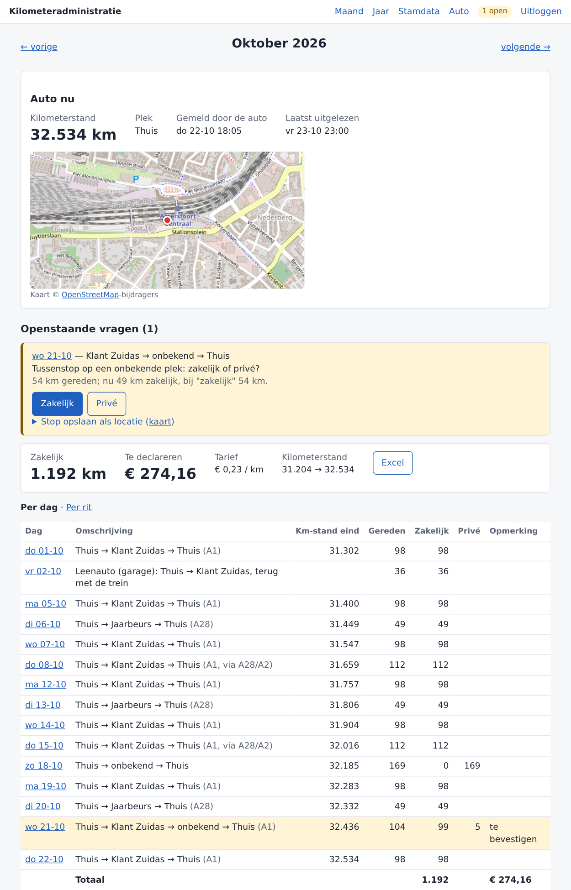
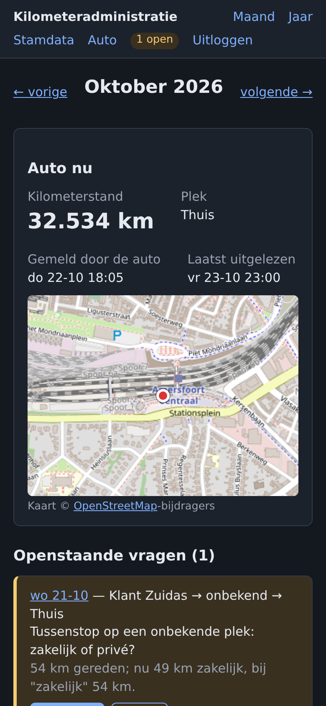
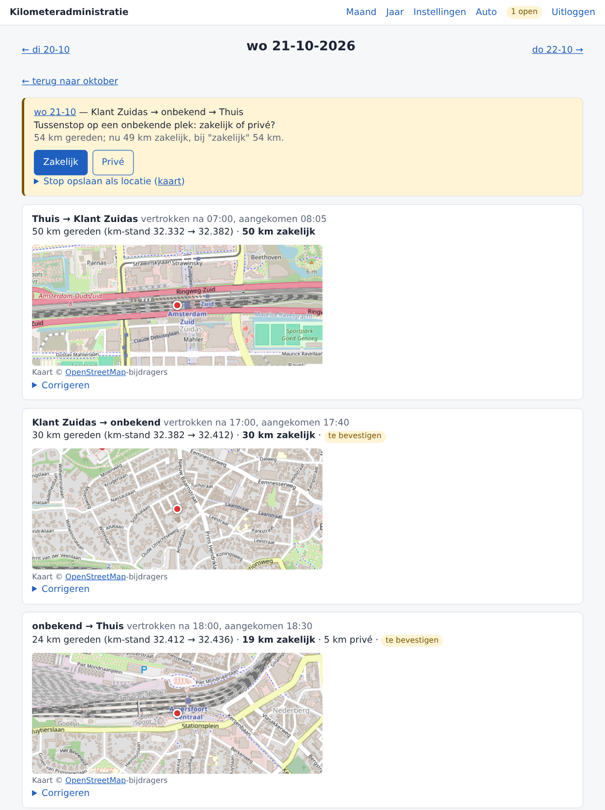
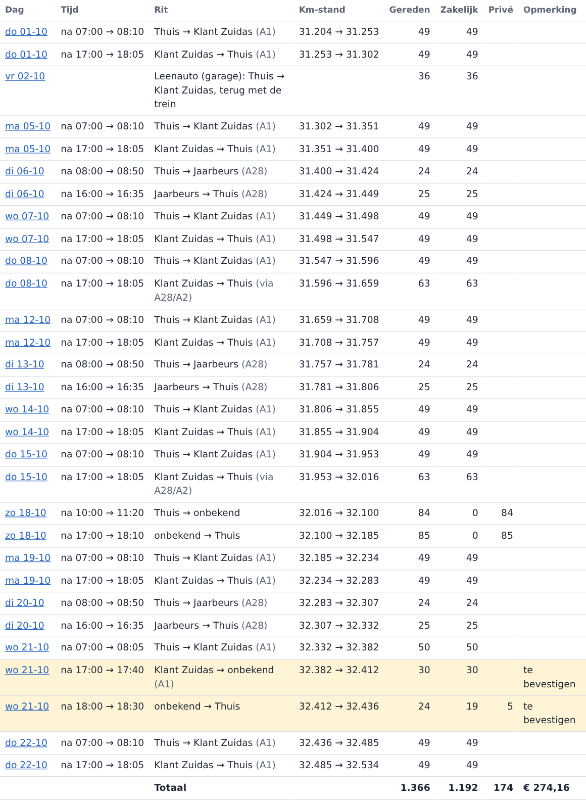
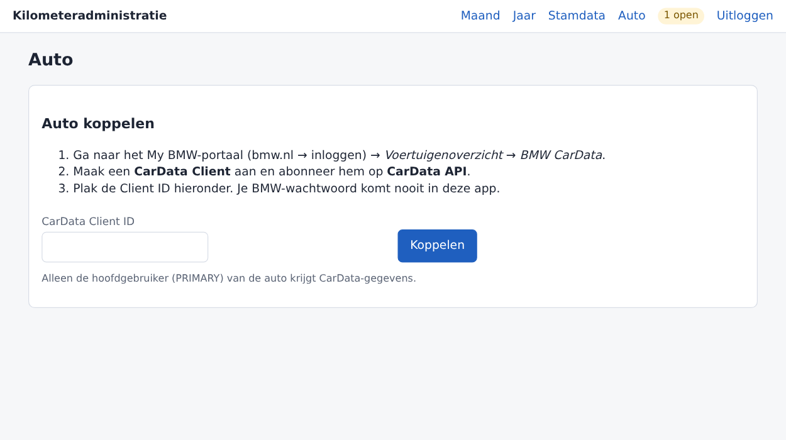
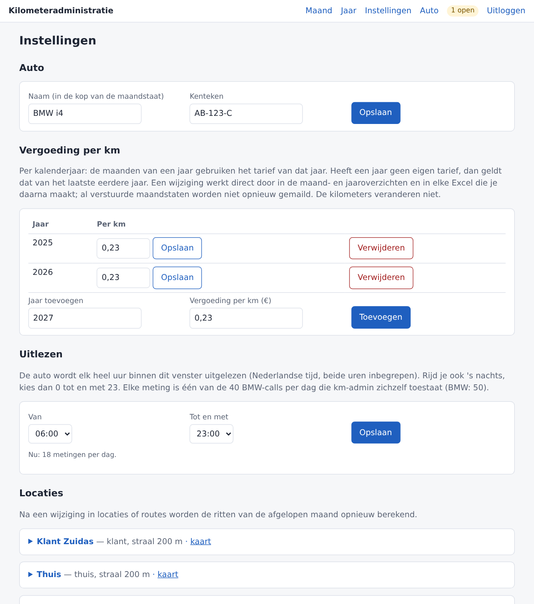
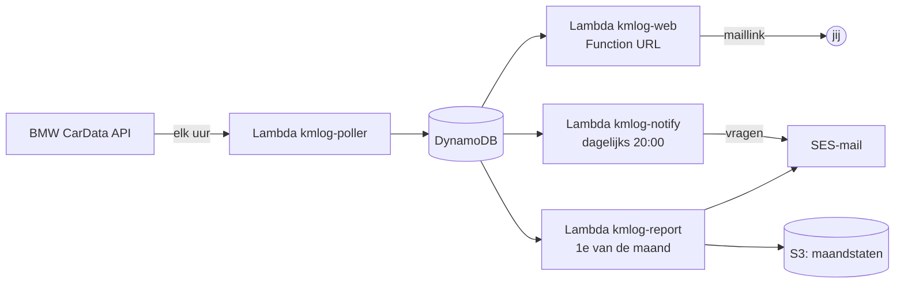

# km-admin: automatische kilometeradministratie voor je BMW

*English summary: km-admin reads the odometer and position of your BMW every hour through the
official BMW CarData API, turns that into trips, classifies them as business or private using
your own places and routes, and mails you a monthly mileage statement (Excel). It runs
serverless in your own AWS account for a few euros a month. The UI and documents are in Dutch.*

Rijd je zakelijk met je privé-BMW en declareer je de kilometers bij je eigen bv? Dan hoef je
met km-admin geen rittenadministratie meer bij te houden. De auto is de bron: elk uur wordt de
kilometerstand en de positie uitgelezen. Daaruit volgen de ritten met de exacte kilometers,
en op de 1e van de maand komt de maandstaat in je mail.

<p>
  
  
</p>

## Wat het doet

- **Ritten uit de auto zelf.** De werkelijke kilometerstand na elke rit, via de officiële
  [BMW CarData API](https://bmw-cardata.bmwgroup.com/). Geen app op je telefoon, geen
  geofences, geen vaste afstanden.
- **Zakelijk of privé, automatisch.** Je legt eenmalig je plekken vast (thuis, klant,
  kantoor) en de routes ertussen. Ritten die daarbij passen tellen zakelijk.
- **Conservatief bij twijfel.** Bij een omweg of tussenstop telt alleen de standaardroute als
  zakelijk, en de webinterface (en een dagelijkse mail) vraagt je om bevestiging. Eén klik op
  "Omweg (alle km zakelijk)" of "Privé-stop" en het is verwerkt.
- **Zakelijke ritten in het weekend of op een feestdag** krijgen een vraag. Dagen waarop je de
  auto niet gebruikt, staan ook niet op de maandstaat.
- **Maandstaat en jaaroverzicht** als Excel, met per dag de route, gereden, zakelijke en
  privé-kilometers en de kilometerstand. Het tarief per km stel je per jaar in.
- **Webinterface** voor telefoon en desktop: maand-, dag- en jaaroverzicht, kaartjes van
  elke aankomstplek, correcties, handmatige ritten (bijv. met een leenauto), instellingen, en
  het koppelen van de auto. Inloggen gaat zonder wachtwoord, met een link per mail.
- **Draait in je eigen AWS-account**, serverless, voor een paar euro per maand. Er gaat
  niets naar derden behalve de kaarttegels van OpenStreetMap in je browser.

| Dag met kaartjes per rit | Per rit, met kilometerstanden |
|---|---|
|  |  |

| Auto koppelen | Instellingen: auto, vergoeding per jaar, uitlezen |
|---|---|
|  |  |

*(De screenshots tonen verzonnen ritten tussen openbare plekken.)*

## Hoe het werkt



1. **Pollen.** Elk heel uur haalt de poller kilometerstand en positie op, binnen een venster
   dat je in de webinterface instelt (**Instellingen → Uitlezen**). Standaard is dat 06:00 tot en
   met 23:00, 18 calls per dag. Rijd je ook 's nachts, kies dan 00:00 tot en met 23:00 (24 calls).
   BMW staat 50 API-calls per 24 uur toe; km-admin stopt zichzelf bij 40 en weigert een venster
   dat daar niet ruim in past.
2. **Ritten afleiden.** Zolang de kilometerstand gelijk blijft, staat de auto stil. Tussen
   twee stilstanden ligt een rit met precies het verschil in kilometerstand.
3. **Classificeren.** Ritten worden vergeleken met je bekende routes (±5 km). Wat niet past,
   wordt een vraag, met een veilige standaard als je niets antwoordt.
4. **Rapporteren.** Op de 1e van de maand gaat de maandstaat als Excel naar je mail en naar
   S3. In december komt het jaaroverzicht mee.

Het volledige ontwerp, met alle regels en voorbeelddagen, staat in
[`docs/ONTWERP.md`](docs/ONTWERP.md).

## Wat je nodig hebt

- Een **BMW** waarvan jij in de My BMW-app de **hoofdgebruiker** bent (BMW noemt dat
  "PRIMARY"). Getest met een BMW i4. Andere merken worden niet ondersteund.
- Een **AWS-account**, plus een IAM-gebruiker om mee te deployen (zie stap 1).
- Een **mailadres op een eigen domein** waarvan je de DNS kunt beheren. Daar komen de
  maandstaten, de vragen en de inloglinks binnen, en vanaf dat adres worden ze ook verstuurd.
  Gmail- of Outlook.com-adressen werken niet als afzender.
- Op je computer: [Terraform](https://developer.hashicorp.com/terraform/install) ≥ 1.10,
  [uv](https://docs.astral.sh/uv/), de [AWS CLI](https://aws.amazon.com/cli/) en `git`.
  Of open de repo in de **devcontainer** (VS Code: *Reopen in Container*), daar staat dit
  allemaal klaar.

## Installeren

Reken op een uur, vooral door het wachten op mails en DNS. Alle commando's draai je vanuit de
root van de repo.

### 1. AWS: deploy-gebruiker aanmaken

Terraform draait met een eigen IAM-gebruiker met beperkte rechten. Die mag alleen resources
met de naam `kmlog-*` beheren, en elke rol die hij maakt krijgt een *permissions boundary*.
Maak in de AWS-console, als admin:

1. Een policy **`kmlog-boundary`** met de inhoud van
   [`infra/iam/boundary-policy.json`](infra/iam/boundary-policy.json). Hang die nergens aan.
2. Een policy **`kmlog-deployer`** met de inhoud van
   [`infra/iam/deployer-policy.json`](infra/iam/deployer-policy.json).
3. Een IAM-gebruiker (bijv. `kmlog-deployer`, zonder console-toegang) met de policy
   `kmlog-deployer`, plus een access key voor de CLI.

Zet de access key in `.env`. Dat bestand is gitignored.

```sh
cp .env.example .env        # vul AWS_ACCESS_KEY_ID en AWS_SECRET_ACCESS_KEY in
set -a; . ./.env; set +a    # in elke nieuwe shell
aws sts get-caller-identity # controle
```

Meer uitleg, ook over waarom er een boundary is, staat in
[`infra/iam/README.md`](infra/iam/README.md). De policies gaan uit van regio `eu-central-1`
(Frankfurt). Kies je een andere regio, vervang die dan in beide JSON-bestanden en zie
[`infra/README.md`](infra/README.md).

### 2. Terraform-state bucket (eenmalig)

```sh
terraform -chdir=infra/bootstrap init
terraform -chdir=infra/bootstrap apply
```

Dit maakt de S3-bucket `kmlog-tfstate-<account>-<regio>` voor de Terraform-state. De
bootstrap-state zelf staat lokaal in `infra/bootstrap/` (gitignored); bewaar die.

### 3. Lambda-code bouwen

```sh
./scripts/build_lambda.sh   # → dist/lambda.zip
```

### 4. Deployen

```sh
ACCOUNT=$(aws sts get-caller-identity --query Account --output text)
terraform -chdir=infra init -backend-config="bucket=kmlog-tfstate-$ACCOUNT-eu-central-1"
terraform -chdir=infra apply -var report_email=jij@jouwdomein.nl
```

Zet `report_email` (en eventuele andere variabelen uit
[`infra/variables.tf`](infra/variables.tf)) in een bestand `infra/terraform.tfvars`
(gitignored), dan hoef je ze niet elke keer mee te geven:

```hcl
report_email = "jij@jouwdomein.nl"
# alert_email = "andere@jouwdomein.nl"   # alarmen en budget, standaard report_email
```

### 5. Mail activeren

Na de apply komen er twee mails van AWS binnen:

- **SES-verificatie**: klik de link, anders kan km-admin geen mail versturen.
- **SNS-abonnement** voor de alarmen: bevestig het.

Zet daarna de DKIM-records van je maildomein in de DNS. Zonder DKIM wordt de mail bij
domeinen met een strikt DMARC-beleid geweigerd.

```sh
terraform -chdir=infra output dkim_dns_records   # drie CNAME-records
```

Kan je DNS-provider geen CNAME onder `_domainkey` aanmaken, gebruik dan je eigen sleutel met
één TXT-record (Bring Your Own DKIM, zie [`infra/README.md`](infra/README.md#mail-en-dkim)).

### 6. Inloggen

```sh
terraform -chdir=infra output web_url
```

Open de URL. Het handigst is als bladwijzer of op je beginscherm. Klik op **Stuur inloglink**:
de link komt naar `report_email` en werkt één keer, binnen 15 minuten. Je blijft daarna 30
dagen ingelogd op dat apparaat.

### 7. Auto koppelen

1. Log in op het [My BMW-portaal](https://www.bmw.nl/) → **Voertuigenoverzicht** →
   **BMW CarData**.
2. Maak een **CarData Client** aan en abonneer hem op **CarData API**. Doe dat vóór de
   volgende stap, anders mist de koppeling de juiste rechten.
3. Ga in km-admin naar **Auto**, plak de **Client ID** en klik op **Koppelen**.
4. km-admin toont een code. Open de BMW-link die verschijnt (of ga zelf naar My BMW →
   **Voertuigenoverzicht** → **BMW CarData**), log in, **vul de code in** en keur de toegang
   goed. De code is een paar minuten geldig.
5. Klik in km-admin op **Ik heb bevestigd**.

De BMW-tokens komen in AWS Secrets Manager (`kmlog/cardata`) en worden daarna alleen nog door
de Lambdas gebruikt. Je BMW-wachtwoord komt nooit in km-admin. De volgende poll (op het hele
uur) haalt de eerste kilometerstand op. Ontkoppelen kan op dezelfde pagina; je ritten blijven
dan bewaard.

### 8. Instellingen invullen

Ga naar **Instellingen**:

- **Auto**: naam en kenteken. Die komen in de kop van de maandstaat.
- **Vergoeding per km**: per kalenderjaar. De maanden van een jaar gebruiken het tarief van dat
  jaar; heeft een jaar geen eigen tarief, dan geldt dat van het laatste eerdere jaar. Je kunt
  dus meerdere jaren vastleggen, en een nieuw jaar hoef je alleen toe te voegen als het tarief
  verandert. Een wijziging werkt direct door in de overzichten en in elke Excel die je daarna
  maakt; al verstuurde maandstaten worden niet opnieuw gemaild.
- **Uitlezen**: het venster waarin de auto elk uur wordt uitgelezen (standaard 06:00–23:00).
- **Locaties**: in elk geval **Thuis** en je klant of kantoor, met coördinaten (rechtsklik in
  Google Maps → kopieer de coördinaten). Een onbekende stop kun je ook later vanuit een vraag
  als locatie opslaan.
- **Routes**: de afstand (enkele reis) tussen thuis en elke zakelijke locatie, met één
  standaardroute per paar. Heb je bij file een vaste alternatieve route, voeg die dan ook toe.
  Zo'n rit telt dan zonder vraag als zakelijk.

Liever auto, tarieven, locaties en routes in een bestand? Kopieer
[`data/samples/stamdata.example.toml`](data/samples/stamdata.example.toml) naar
`data/stamdata.toml` en laad het met `uv run kmlog --store dynamodb stamdata`.

Klaar. Vanaf nu:

- **elke avond om 20:00** een mail als er nieuwe vragen zijn;
- **op de 1e van de maand** de maandstaat (Excel) in je mail.

Een maandstaat tussendoor kan altijd via de knop **Excel** op de maandpagina.

## Kosten

Bij normaal gebruik een paar euro per maand, meestal minder:

- DynamoDB on-demand, ~550 Lambda-runs per maand en wat S3 vallen grotendeels binnen de
  gratis laag;
- twee secrets in Secrets Manager kosten samen ~$0,80 per maand.

Terraform maakt een budget `kmlog-monthly` aan dat mailt bij 80% en 100% van $5. Activeer
daarvoor eenmalig de cost-allocation-tag `project` (Billing → Cost allocation tags).

## Bijwerken

```sh
git pull
set -a; . ./.env; set +a
./scripts/build_lambda.sh && terraform -chdir=infra apply
```

## Problemen oplossen

| Symptoom | Oplossing |
|---|---|
| Geen inlogmail | SES-verificatie geklikt? Kijk in je spam. Maximaal 5 inlogmails per uur. |
| Mail komt niet aan, bounce "DMARC" | DKIM-records uit stap 5 staan nog niet (goed) in de DNS. |
| Alarm `kmlog-poller-errors` | Meestal een verlopen BMW-koppeling (bijv. na een nieuw BMW-wachtwoord). **Auto → Ontkoppelen**, dan opnieuw koppelen. |
| "BMW weigert de aanvraag" bij koppelen | Client ID klopt niet, of de client is niet geabonneerd op *CarData API*. |
| Geen gegevens na koppelen | Alleen de hoofdgebruiker (PRIMARY) van de auto krijgt CarData-gegevens. |
| Rit verkeerd ingedeeld | Op de dagpagina: **Corrigeren**, of de stop als locatie opslaan. Antwoorden en correcties blijven bewaard als ritten opnieuw worden berekend. |

Logs: `aws logs tail /aws/lambda/kmlog-poller --since 1d` (één regel per poll, zonder
coördinaten).

## Lokaal ontwikkelen

```sh
uv sync
uv run pytest
uv run ruff check . && uv run ruff format --check .
```

Werk je met een AI-assistent? Die vindt in [`AGENTS.md`](AGENTS.md)
de aanwijzingen voor deployen, beheren en aanpassen.

De rekenregels zijn getest op de voorbeelddagen uit `docs/ONTWERP.md` §7.3
(`tests/test_voorbeelddagen.py`). Lokaal kan km-admin ook met SQLite werken
(`uv run kmlog --help`), bijvoorbeeld om een maandstaat te maken uit een database-export.

## Beperkingen

- Alleen BMW, en één auto per installatie.
- Eén gebruiker per installatie: de mail naar `report_email` is de enige manier om in te
  loggen.
- km-admin ziet alleen wat de auto bij elke poll (elk uur) meldt. Meerdere korte stops binnen
  één uur worden daardoor één rit; de kilometers kloppen wel.
- km-admin is geen fiscaal advies. Controleer zelf of het tarief en je rittenregistratie
  voldoen aan wat je bv en de Belastingdienst verlangen.

## Licentie

[MIT](LICENSE). Gebruiken, aanpassen en delen mag, ook commercieel.

BMW en CarData zijn merken van de BMW Group. Dit project is niet verbonden aan BMW.
